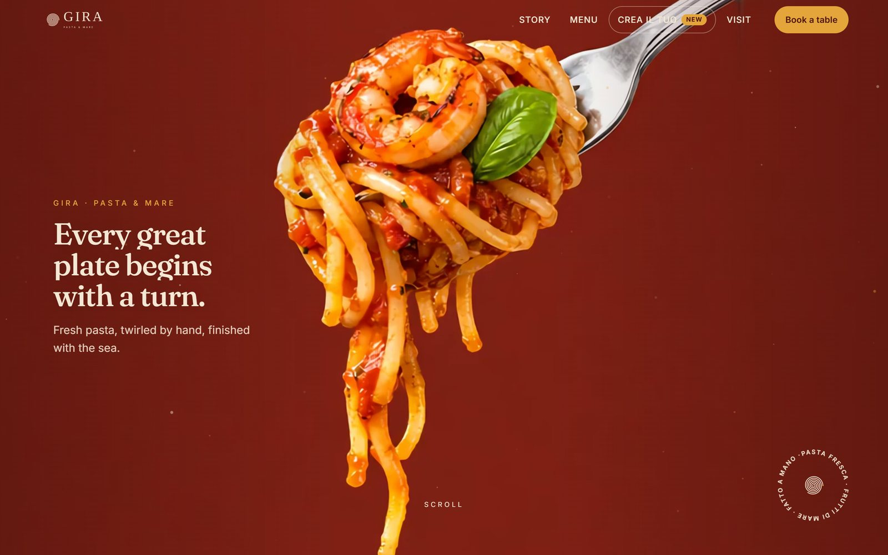
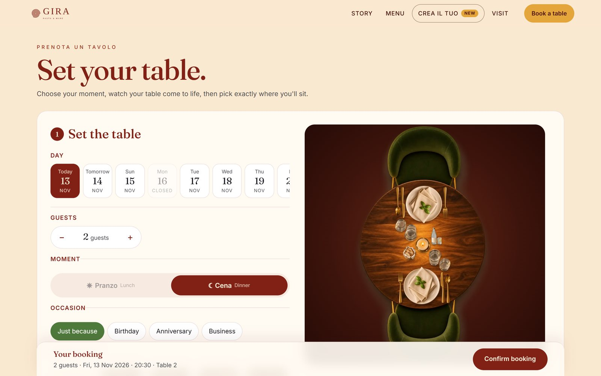
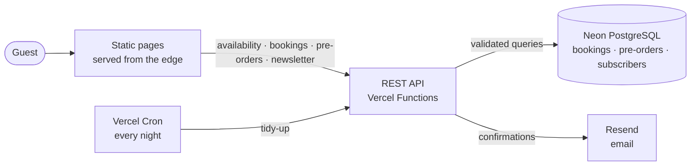

<div align="center">


# GIRA — Pasta & Mare

### Every great plate begins with a turn.

A restaurant website that feels like walking through the door:
a story told by scrolling, a plate you build with your own hands,
and a table that is set for you — and kept for you — the moment you book it.

**[Visit the live site →](https://YOUR-LIVE-URL)**

[](https://github.com/siwar224/GIRA/actions/workflows/ci.yml)


</div>



---

## The story

GIRA is a small Italian kitchen built around a single idea: **pasta rolled that morning, seafood
bought at the market at six, and a pan hot enough to bring them together in minutes.** Twelve
shapes rolled by hand. Forty seats, never more.

A place like that doesn't need a website that lists things. It needs one that *feels* like it —
warm, unhurried, a little theatrical, and completely reliable when you ask it to hold your table.
That became the brief, and every part of the site follows a guest through one evening.

### 1 · The turn

You arrive, and a forkful of pasta begins to spin. As you scroll, it turns into a spiral of the
sea and lands on your screen as a finished plate — 376 hand-prepared frames, played at the speed
of your hand. The name *Gira* means "it turns", and the whole brand lives in that one motion.

### 2 · The kitchen

The story of the kitchen unfolds next: the flour, the bronze dies, the morning market. Then the
menu, a photo for every dish — and each signature pasta carries a quiet invitation:
*make it yours*.

### 3 · Crea il tuo — your plate

Choose a pasta, a sauce and up to three treasures from the sea, then drag each ingredient exactly
where you want it on the plate. The price and the allergens follow every choice, live, because a
guest should never have to ask.

<table>
  <tr>
    <td width="50%"></td>
    <td width="50%"></td>
  </tr>
  <tr>
    <td align="center"><sub>Crea il tuo — your plate, turned your way</sub></td>
    <td align="center"><sub>Prenota — the table sets itself for your party</sub></td>
  </tr>
</table>

### 4 · Prenota — your table

Booking is not a form; it is the moment you set your own table. Pick lunch or dinner and the light
changes. Add a guest and a new place setting appears. Turn a spiral dial to your time, then choose
the exact table on a floor plan of the room — by the window, at the chef's counter, or on the
terrace under the olive trees. You leave with a ticket, a booking code and a calendar entry —
and a confirmation is already waiting in your inbox.


### 5 · Before the evening — your booking, in your hands

Plans change, appetites grow. With nothing more than your booking code and the phone number you
booked with — no account, no password — you can find your booking again, send the plates you built
in *Crea il tuo* to the kitchen so they're ready when you sit down, or cancel and free the table
for someone else. Nothing is paid online; the restaurant prices every plate itself.

### 6 · Behind the door — a promise that holds

The first version of GIRA was all front of house: beautiful, but its bookings only lived in your
own browser. Two guests could "book" the same table, and the restaurant would never know.

So the project grew a real back of house. Availability now comes from a live database; every
booking is checked by the server and stored; the booking code is issued by the restaurant, not the
browser; confirmations go out by email; pre-orders reach the kitchen; and every night the restaurant
quietly forgets the evening that has passed. The experience on screen barely changed —
**it simply started telling the truth.**

---

## What makes it work

**One table, one guest — guaranteed.**
If two people press *Confirm* on the same table at the same instant, exactly one of them gets it.
That rule isn't left to application code and good timing: it is written into the database itself,
which refuses any two bookings that overlap. The other guest is told kindly, and the floor plan
refreshes so they can pick again.

**A table is held for the whole meal.**
Each booking keeps its table for two hours, so a 19:30 reservation also blocks 20:00 and 21:00 —
and frees it again at 21:30, exactly when the first party leaves.

**Checked twice, written once.**
The same set of rules checks your details in the browser — instant feedback, no waiting — and
again on the server, which never trusts what it receives.

**Priced by the kitchen, not the browser.**
A pre-order carries only the plates you chose. Every price is worked out again on the server from
the menu itself, so the bill can't be edited from a browser.

**Yours, without an account.**
A random booking code plus your phone number is all it takes to find, change or cancel a booking.
A wrong guess gets the same polite "not found" either way, so nobody can fish for other people's
bookings.

**Nothing lingers.**
Every night a scheduled job clears the bookings (and pre-orders) of evenings that are over, so guest
details are kept only as long as they are useful.

**Respectful by design.**
No address is ever stored as-is for rate limiting, bots are caught without making people solve
puzzles, personal details never appear in logs, and the site never reveals whether an email is
already on the newsletter.

**Built for everyone.**
Every visual has real text underneath, the whole journey works from the keyboard (the time dial
turns with the arrow keys), contrast meets WCAG AA, touch targets are generous, and every
animation steps aside for visitors who prefer reduced motion.

**Content apart from code.**
Every word, price, opening hour and table lives in one content layer, so the restaurant can change
its menu without touching a component.

---

## Technology

| Layer | Technology | Why it's here |
|---|---|---|
| **Experience** | Next.js 15 · React 19 | Pages are pre-rendered and served from the edge: the story loads instantly, anywhere |
| **Language** | TypeScript (strict) | One typed language from the button to the database query |
| **Design** | Tailwind CSS 4 · hand-made design tokens | The GIRA palette and typography, applied with precision, no UI kit |
| **Motion** | GSAP 3 · Lenis | Scroll-driven storytelling, smooth and frame-accurate |
| **API** | Next.js Route Handlers on Vercel Functions | A lightweight REST API that scales to zero when the room is quiet |
| **Data** | Neon serverless PostgreSQL | Real relational guarantees — the no-double-booking rule lives here |
| **Validation** | zod | One set of rules, shared by the browser and the server |
| **Email** | Resend | Branded confirmation and cancellation emails, sent after the response so nobody waits |
| **Scheduling** | Vercel Cron | The nightly tidy-up of past bookings |
| **Quality** | Vitest · ESLint · GitHub Actions | 110+ automated tests, including real concurrency checks against Postgres, on every push |
| **Hosting** | Vercel · Neon free tiers | Production-grade, and free to run at portfolio scale |



---

## Run it locally

You'll need **Node.js 20+** and a free [Neon](https://neon.com) database
(on Vercel: *Storage → Neon → Create*, then connect it to the project).

```bash
npm install
cp .env.example .env.local   # then fill in the values
npm run db:migrate           # creates or updates the tables
npm run dev                  # http://localhost:3000
```

| Command | What it does |
|---|---|
| `npm run dev` | Start the development server |
| `npm test` | Run the test suite |
| `npm run lint` · `npm run typecheck` | Code quality checks |
| `npm run build` | Production build |
| `npm run db:migrate` | Apply database migrations |

Every setting is described in [`.env.example`](.env.example) — emails and the nightly tidy-up
are optional and switch on when their keys are set. Secrets stay on the server and never reach
the browser.

---

## What's next

- **The kitchen's view** — tonight's tables and pre-orders on one screen for the team
- **A waiting list** — when a moment is full, leave your number and be told if a table frees up
- **Reminders** — a short note the morning of your booking, with a one-tap way to cancel

Opening hours, address, prices and tables are demonstration content for now.

---

## License

The source code is released under the [MIT License](LICENSE).
The GIRA name, logo, photographs, video frames and illustrations are **not** covered by that
license — all rights reserved.

<div align="center">
<sub>Designed and built by <a href="https://github.com/siwar224">siwar224</a>.</sub>
</div>
