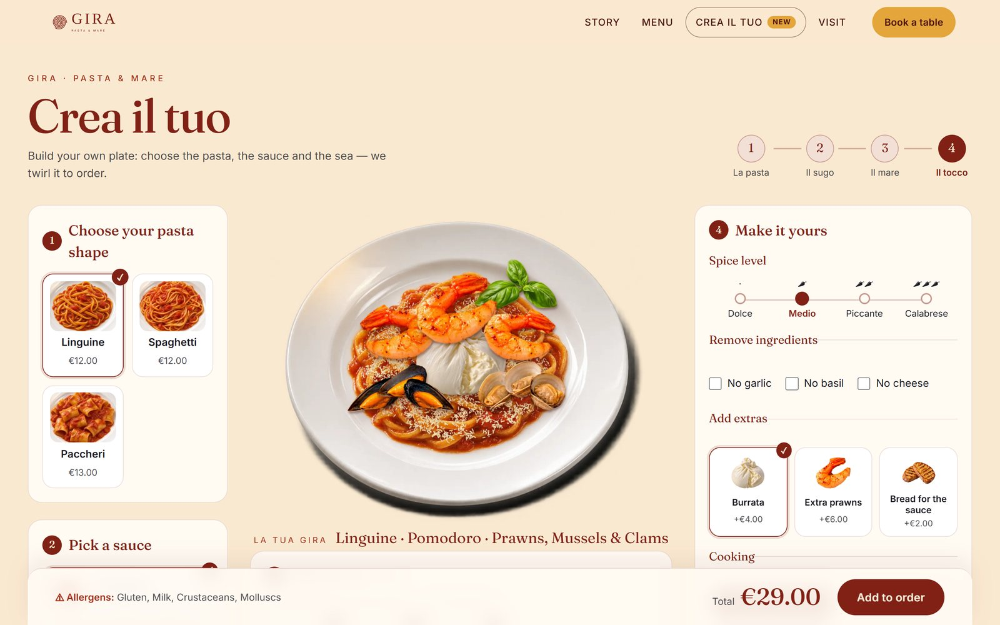
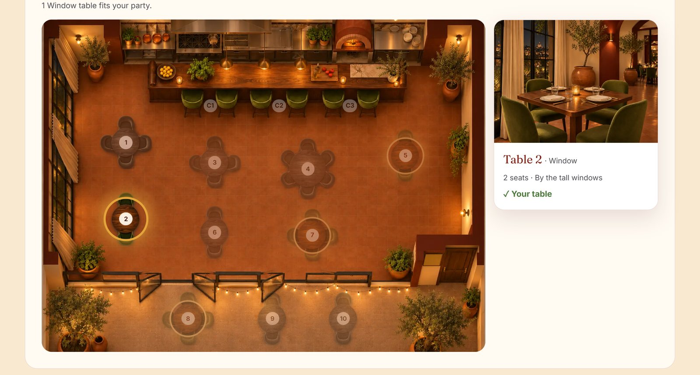

<div align="center">


# GIRA — Pasta & Mare

**Every great plate begins with a turn.**

The website of GIRA, an Italian restaurant for fresh pasta and seafood: a scroll-driven story,
a build-your-own plate studio and a booking experience that sets your table as you choose.


</div>


## What's inside

| | |
|---|---|
| **The turn** — scroll-scrubbed hero | 376 hand-cut frames drawn to a canvas as you scroll: a forkful of pasta becomes a spiral of the sea and lands as a finished plate. Text beats, breathing light and particles ride on top. |
| **La nostra storia & menu** | Animated counters, the kitchen's story, and a tabbed menu with a photo for every dish. Signature pastas link straight into the plate builder, already set up. |
| **Crea il tuo** — build your plate | Pick the pasta, sauce and up to three treasures from the sea, then drag ingredients exactly where you want them on the plate. Live price, allergens and a cart that survives a refresh. |
| **Prenota** — book a table | Lunch or dinner changes the light. The table is set for your party in real time, a spiral dial turns to your time, and an interactive floor plan lets you pick the exact table. Availability is live and every booking is saved on the server. Ends with a ticket and a calendar file. |

<table>
  <tr>
    <td width="50%"></td>
    <td width="50%"></td>
  </tr>
  <tr>
    <td align="center"><sub>Crea il tuo — your plate, turned your way</sub></td>
    <td align="center"><sub>Prenota — the table sets itself for your party</sub></td>
  </tr>
</table>



## Built with

- **Next.js 15** (App Router, static rendering) · **React 19** · **TypeScript** (strict)
- **Tailwind CSS 4** with hand-written design tokens for the GIRA palette
- **GSAP 3** (ScrollTrigger, SplitText) and **Lenis** for scroll-driven motion
- No UI kit, no state library: drag and drop and the cart are plain React and `localStorage`
- **Next.js Route Handlers** (Vercel Functions) · **Neon Postgres** · **zod** for bookings and the newsletter

Accessibility is part of the build: real HTML text over every visual, full keyboard support
(the time dial turns with the arrow keys), visible focus, 44 px touch targets, WCAG AA contrast,
and `prefers-reduced-motion` respected everywhere.

## Getting started

Requires **Node.js 20+**.

```bash
npm install
npm run dev
```

Open http://localhost:3000.

| Script | What it does |
|---|---|
| `npm run dev` | Development server (regenerates the frame manifest first) |
| `npm run build` | Production build |
| `npm start` | Serve the production build |
| `npm run lint` | ESLint |
| `npm run typecheck` | TypeScript, no emit |
| `npm run db:migrate` | Apply pending SQL migrations from `db/migrations` |
| `npm test` | Vitest, once (`npm run test:watch` to keep it running) |

### Tests

```
tests/
  lib/      opening hours → slots, table fit, validation schemas
  server/   HTTP helpers, booking service (database mocked)
  api/      the three route handlers end to end, service mocked
  db/       the database's own guarantees, on real Postgres
```

The `db/` tests prove what the code relies on: overlapping bookings are refused (even two
inserts racing each other), back-to-back bookings are allowed, codes are unique. They run
only when `TEST_DATABASE_URL` points at a **separate** Neon branch (create one in the Neon
console, *Branches → New branch*), inside a throwaway schema that is dropped afterwards.

GitHub Actions runs lint, typecheck, tests and a production build on every push and pull
request (`.github/workflows/ci.yml`). Add `TEST_DATABASE_URL` as a repository secret to
include the database tests there too.

### Database

Bookings and newsletter sign-ups are stored in [Neon](https://neon.com) Postgres (free plan).

1. In the Vercel project, open **Storage → Neon → Create** and connect it to the project.
   This sets `DATABASE_URL` and `DATABASE_URL_UNPOOLED` for every environment.
2. Copy `.env.example` to `.env.local` and paste the same two values
   (or run `vercel env pull .env.local`).
3. Run `npm run db:migrate` once, and again whenever a new file lands in `db/migrations`.

Database access lives in `src/server/` and is marked `server-only`: importing it from a
client component fails the build, so connection strings can never reach the browser.

Also set `RATE_LIMIT_SALT` (a random secret, see `.env.example`) and `DEMO_OCCUPANCY`
in `.env.local` and in the Vercel project's environment variables.

## API

| Method | Path | What it does |
|---|---|---|
| `GET` | `/api/availability?date=YYYY-MM-DD` | Every bookable time of the day and the tables already held then |
| `POST` | `/api/bookings` | Books a table; the server re-checks hours, party size and the table, then issues the code |
| `POST` | `/api/newsletter` | Adds an address to "La lettera" (signing up twice changes nothing) |

- **No double bookings.** A Postgres exclusion constraint forbids two bookings of the same
  table with overlapping times (each booking holds its table for 2 hours), so two guests
  pressing "Confirm" at the same instant can't both win: the second gets `409 table_taken`.
- **Validation twice.** The same zod schemas (`src/lib/schemas.ts`) check the form in the
  browser and every request on the server.
- **Protection.** Writes must come from the site's own origin, bodies are size-capped JSON,
  a honeypot field catches bots, and requests are rate-limited per client (salted IP hash,
  no raw IPs stored).
- **One error shape.** `{ "error": { "code", "message", "fields"? } }` with the right status:
  `403`, `409`, `413`, `415`, `422`, `429` (with `Retry-After`), `500`.

## Project structure

```
src/
  app/            routes: / (landing), /crea-il-tuo, /prenota, sitemap, robots
  components/     hero/, crea/, booking/ and the landing sections
  content/        every word on the site, plus menu, ingredients, tables and areas
  lib/            frame loader, pricing, cart, availability, calendar export
  server/         server-only code: environment check, database client
db/
  migrations/     plain SQL, applied in order by scripts/migrate.mjs
public/
  frames/         the hero frame sequence
  crea/           plates and ingredients for the builder
  book/           tables, props and room views for booking
scripts/          frame manifest generator and asset helpers
```

All copy lives in `src/content/*.ts`, so text, prices, opening hours and tables can be
changed without touching a component.

## Deployment

The pages are static and deploy to [Vercel](https://vercel.com): import the repository,
keep the detected Next.js settings, and deploy. The database needs the one-time setup
described under [Database](#database).

## Status

Opening hours, address, prices and the tables are demo data for now and will be replaced
with the restaurant's real information. With `DEMO_OCCUPANCY=true` the floor plan also shows
some believable "already booked" tables on top of the real bookings.

## License

The source code is released under the [MIT License](LICENSE).
The GIRA name, logo, photographs, video frames and illustrations are **not** covered by that
license — all rights reserved.
